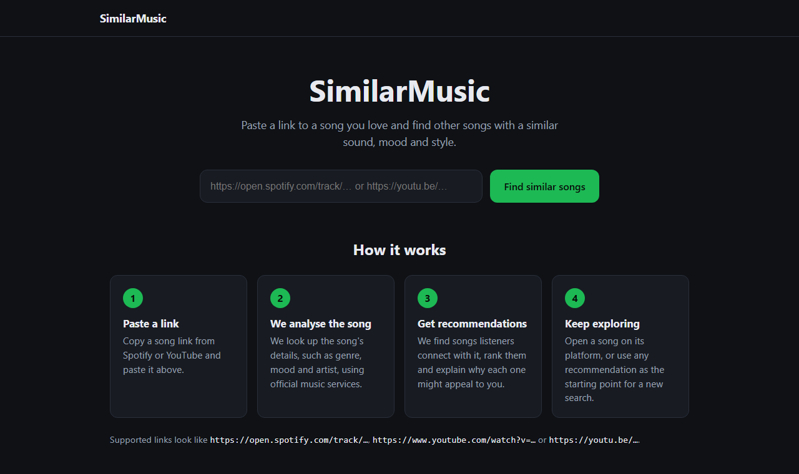
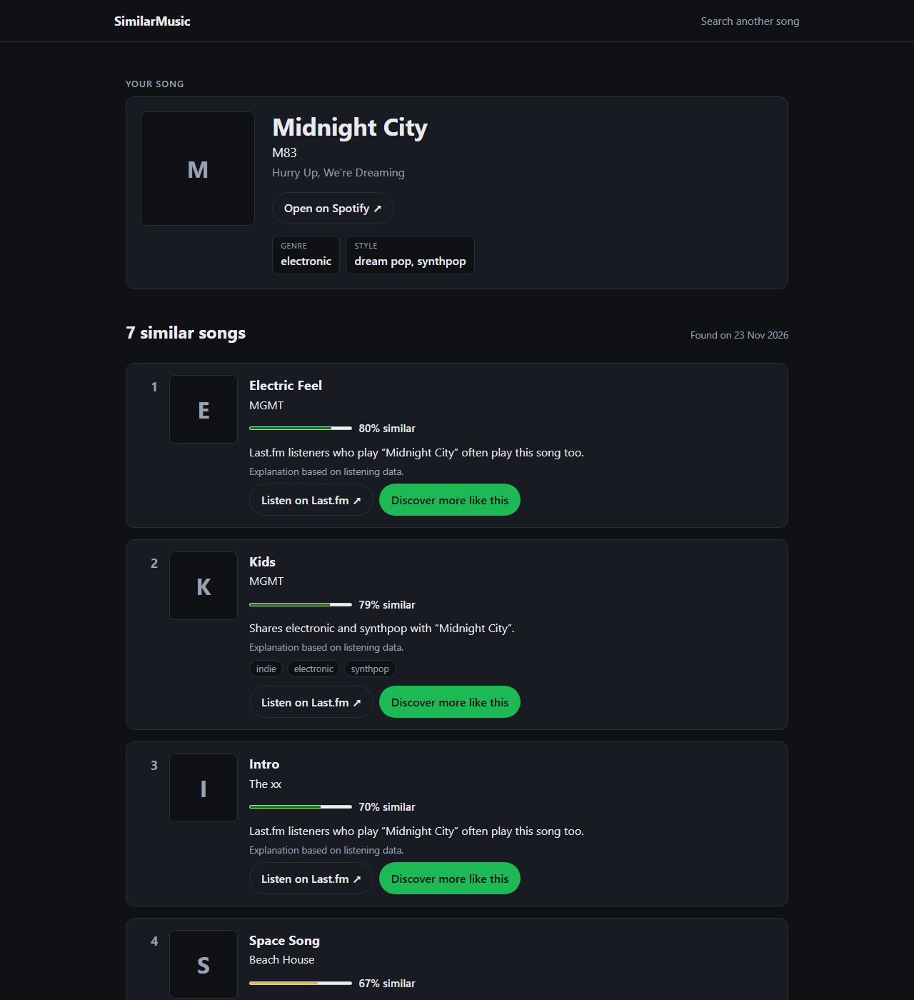
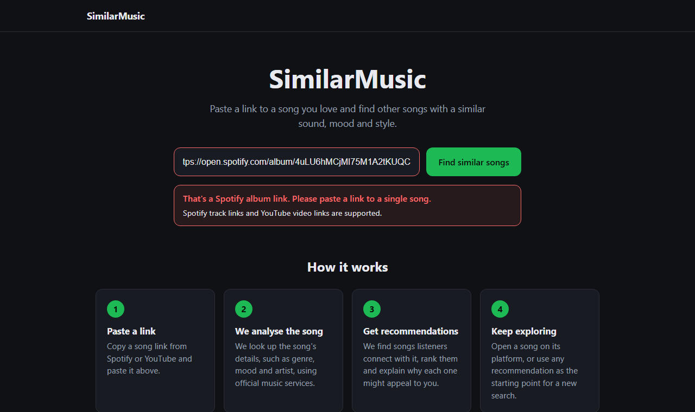
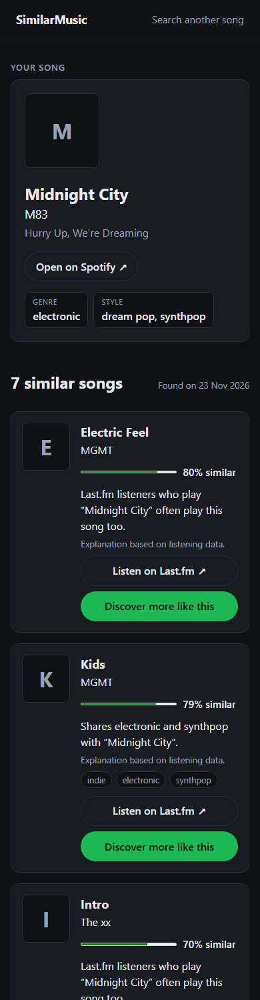

# SimilarMusic

A web app for discovering music: paste a link to a song you like and get similar songs back, ranked by AI with a short explanation for each.

> **Status:** complete (phases 1–6). Paste a link on the home page, wait while the song is identified, discovered and analysed, and browse the ranked recommendations with artwork, scores and explanations; any recommendation can start a new search.

## Screenshots

Paste a Spotify or YouTube song link:



The results: the song's characteristics (with the evidence behind them), then similar songs ranked by score, each with the reason it was recommended, a link to listen and **Discover more like this**:



Clear errors that say what to do next, and a layout that works on phones:





*Taken with the test suite's sample Last.fm data and a stand-in for the AI, so no API keys were used. That's why the explanations here come from listening data and the artwork shows placeholders. With real credentials, the explanations are written by the AI and the artwork comes from Spotify.*

## Requirements

- Python 3.10 or newer (`python --version`)
- API credentials (all free to create, see below):
  - **Required:** a Last.fm API key and an Anthropic (Claude) API key.
  - **At least one of:** Spotify app credentials (for Spotify links) or a YouTube Data API key (for YouTube links). Spotify credentials also add artwork and Spotify links to the recommendations.
- No database server: SQLite is built into Python.

## Setup

1. Get the code and open a terminal in the project folder.
2. Create a virtual environment and install the dependencies:

   ```bash
   python -m venv .venv
   # Windows (PowerShell)
   .venv\Scripts\Activate.ps1
   # macOS / Linux
   source .venv/bin/activate

   pip install -r requirements.txt
   ```
3. Create your configuration file from the example and fill in your credentials (next section):

   ```bash
   cp .env.example .env        # Windows: copy .env.example .env
   ```

   `.env` is listed in `.gitignore`; never commit it. Values set as real environment variables take priority over `.env`.
4. Start the app (see [Run](#run)). The SQLite database (`similarmusic.db` by default) is created automatically on first start.

## API credentials

Put credentials in `.env`. See `.env.example` for every variable.

| Service | Used for | How to get credentials |
| --- | --- | --- |
| Spotify Web API | Track title, artists, album, artwork, release date | Create an app at the [Spotify developer dashboard](https://developer.spotify.com/dashboard) and copy its Client ID and Client Secret. Development Mode apps need the owner to have Spotify Premium. |
| YouTube Data API v3 | Video title, channel, thumbnail, duration, tags | Enable the API in [Google Cloud Console](https://console.cloud.google.com/apis/library/youtube.googleapis.com) and create an API key. |
| Last.fm API | Similar tracks and artists, genre/mood/style tags | [Create an API account](https://www.last.fm/api/account/create) (free, non-commercial use) and copy the API key. |
| Claude API (Anthropic) | Song analysis, candidate evaluation and explanations | Create a key in the [Claude Console](https://platform.claude.com/) and set `ANTHROPIC_API_KEY`. |

Without credentials for a service, the features that need it return a clear "not configured" error. Everything else keeps working.

Looked-up songs and completed recommendations are stored in SQLite, so repeating a request (within `RECOMMENDATION_CACHE_HOURS`, default 24) uses no API quota.

**Cost:** Spotify, YouTube and Last.fm are free within their quotas (YouTube: 10,000 units a day, 1 per song lookup). The Claude API is paid per token: each new song (not cached) makes two calls to `AI_MODEL`. Use a cheaper model or lower `AI_EFFORT` to reduce cost.

## Configuration

All settings are environment variables (or lines in `.env`):

| Variable | Default | Meaning |
| --- | --- | --- |
| `SPOTIFY_CLIENT_ID`, `SPOTIFY_CLIENT_SECRET` | – | Spotify app credentials (Client Credentials flow) |
| `SPOTIFY_MARKET` | `US` | Two-letter country code for track availability |
| `YOUTUBE_API_KEY` | – | YouTube Data API v3 key |
| `LASTFM_API_KEY` | – | Last.fm API key |
| `ANTHROPIC_API_KEY` | – | Claude API key |
| `AI_MODEL` | `claude-opus-5-5` | Claude model used for analysis and ranking |
| `AI_EFFORT` | `medium` | `low`, `medium`, `high`, `xhigh` or `max` |
| `AI_TIMEOUT_SECONDS` | `120` | Per AI call (at most 130; one retry is made) |
| `RECOMMENDATION_COUNT` | `10` | Recommendations per result (1–25) |
| `RECOMMENDATION_CACHE_HOURS` | `24` | How long a result is reused for the same song (0 = never) |
| `RECOMMENDATIONS_PER_CLIENT_PER_HOUR` | `30` | Recommendation requests one IP address may make per hour (0 = unlimited) |
| `HTTP_TIMEOUT_SECONDS` | `10` | Per request to Spotify, YouTube and Last.fm (at most 60) |
| `DATABASE_URL` | `sqlite:///./similarmusic.db` | SQLite file (relative to where the app is started) |
| `APP_NAME` | `SimilarMusic` | Name shown in the pages |
| `DEBUG` | `false` | Auto-reload with `python run.py`; never enable on a public server |

Invalid values (for example `AI_TIMEOUT_SECONDS=600`) stop the app at startup with a message naming the setting.

## Run

```bash
python run.py
```

Open http://127.0.0.1:8000. The interactive API documentation is at http://127.0.0.1:8000/docs.

To listen on another address or port, run Uvicorn directly, e.g. `uvicorn app.main:app --host 0.0.0.0 --port 8080`. The app is meant to be run as a single process. If it is put behind a reverse proxy, every request appears to come from the proxy's address, so the per-client request limit applies to all users together; raise `RECOMMENDATIONS_PER_CLIENT_PER_HOUR` or set it to 0 and limit requests at the proxy instead.

To start over with an empty database, stop the app and delete `similarmusic.db`.

## Using it

1. Paste a Spotify track link or a YouTube video link and choose **Find similar songs**. A progress panel shows what is happening (identifying the song, finding similar music, AI analysis, ranking); a first search usually takes 20–60 seconds. **Cancel** (or Esc) stops waiting.
2. The results page (`/results/<id>`, which you can bookmark) shows your song with its artwork, album, a link back to its platform and the characteristics found for it (hover to see the evidence), then the recommendations: artwork, similarity score, the reason it was recommended, tags, a **Listen** link that opens the song in a new tab, and **Discover more like this**, which runs a new search from that song.
3. If something goes wrong (an invalid or unsupported link, a song that can't be found, a music service or the AI being unavailable, or no recommendations), the page says what happened and what to try next, and keeps your link in the box.

### Troubleshooting

| Message | What to do |
| --- | --- |
| "…the server has no AI API key (ANTHROPIC_API_KEY) configured" / "The AI service rejected the server's API key" | Set a valid `ANTHROPIC_API_KEY` in `.env` and restart. |
| "Last.fm rejected the server's API key" / "…no Last.fm API key configured" | Set `LASTFM_API_KEY`. |
| "Spotify rejected the server's API credentials" | Check `SPOTIFY_CLIENT_ID` and `SPOTIFY_CLIENT_SECRET`; a Development Mode app's owner needs Spotify Premium. |
| "YouTube rejected the server's API key" | Check `YOUTUBE_API_KEY` and that the YouTube Data API v3 is enabled for its Google Cloud project. |
| "The YouTube API quota has been used up" | Wait for the daily quota to reset (midnight Pacific time) or use Spotify links. |
| "Couldn't find songs similar to …" | Last.fm has too little data for the song; try a better-known song. |
| "You've asked for a lot of recommendations…" | The per-client limit was reached; wait, or raise `RECOMMENDATIONS_PER_CLIENT_PER_HOUR`. |
| "The AI service took too long to respond" | Try again; a lower `AI_EFFORT` makes calls faster. |

The pages also work without JavaScript: the form posts to `/recommend`, which redirects to the results when they are ready.

## Supported links

- Spotify: `https://open.spotify.com/track/<id>` (including `?si=` share parameters, `intl-xx/` paths and `embed/` links) and `spotify:track:<id>` URIs. Shortened `spotify.link` links aren't supported because resolving them would require fetching a user-supplied URL.
- YouTube: `youtube.com/watch?v=<id>`, `youtu.be/<id>`, `music.youtube.com`, `m.youtube.com`, `/shorts/`, `/embed/` and `/live/` links.

YouTube has no structured song data, so the artist and title are taken from the video title (`Artist - Title`) or from auto-generated `Artist - Topic` channels. The raw title and channel name are returned too.

## How recommendations are made

1. **Identify the song** from its Spotify or YouTube link (official APIs only; the link itself is never fetched).
2. **Discover candidates** on Last.fm from three sources: tracks listeners consider similar, top tracks of similar artists, and top tracks for the song's strongest genre/style tags. The song itself, its remixes, live versions and covers, tracks by the same artist, and karaoke or tribute filler are filtered out, with at most two tracks per artist. Each candidate gets its Last.fm tags.
3. **AI analysis and evaluation** (in parallel, Claude API with schema-constrained JSON):
   - The original song's characteristics (genre, subgenre, mood, style, tempo, energy, danceability, instrumentation, vocals, language). The model receives numbered facts (metadata and tags) and must cite them; any characteristic without a valid citation is dropped and listed as unknown.
   - Each candidate is rated against the original on genre, mood, style, energy, instrumentation and vocals (strong / partial / weak / unknown), with a one- or two-sentence explanation. Responses that reference songs not in the candidate list, use values outside the rubric, or rate candidates that have no tag data are discarded. Titles, artists and links always come from the candidate data, never from the model's text.
4. **Score and rank.** The similarity score (0–1) is a weighted mean of the components that have data:

   | Component | Weight | Source |
   | --- | --- | --- |
   | Listening similarity | 40% | Last.fm track match to the original, or 0.8 × artist match |
   | Tag overlap | 30% | Weighted cosine similarity of the two songs' Last.fm tags |
   | AI rubric | 30% | strong = 1, partial = 0.5, weak = 0, averaged over rated dimensions |

   Missing components are left out and the remaining weights rescaled. Every recommendation returns its breakdown and where its explanation came from (`ai`, or `tags` / `listening_data` when the AI could not explain it from data).
5. **Artwork and listening links.** Last.fm doesn't provide artwork, so each recommended song is searched on Spotify (`GET /v1/search`, which remains available to Development Mode apps after Spotify's February 2026 changes, with at most 10 results per request; 5 are requested). A result is used only when its title and one of its artists match the recommendation (ignoring case, accents, featuring credits and remaster labels); its album artwork and Spotify link are then stored with the song. Songs that Spotify doesn't have keep their Last.fm link and are shown with a placeholder. Searches run four at a time, happen once per song (a miss is retried after a week), and never block the results: if Spotify is unavailable or not configured, recommendations are shown without artwork.

Model and behaviour are configurable: `AI_MODEL` (default `claude-opus-5-5`), `AI_EFFORT` (default `medium`), `AI_TIMEOUT_SECONDS`, `RECOMMENDATION_COUNT` (default 10). For models that support it, server-side refusal fallbacks are enabled so a request declined by a safety classifier is retried on a fallback model instead of failing.

## API

| Endpoint | Purpose |
| --- | --- |
| `POST /api/songs/lookup` `{"url": …}` | The song's metadata. |
| `POST /api/discovery` `{"url": …}` | The song plus the candidate songs found for it (before AI ranking). |
| `POST /api/recommendations` `{"url": …}` or `{"song_id": …}` | Ranked recommendations with scores, breakdowns and explanations. `song_id` (from an earlier result) is "discover more like this". |
| `GET /api/recommendations/{request_id}` | A stored result. |

Each recommendation includes `title`, `artist`, `album`, `artwork_url`, `similarity_score`, `score_breakdown`, `explanation`, `explanation_source`, `tags`, `found_via`, its source `platform`/`url` (Last.fm) and `listen_platform`/`listen_url` (Spotify when matched, otherwise Last.fm).

| Page | Purpose |
| --- | --- |
| `GET /` | Home page with the song link form |
| `POST /recommend` | Form target (`url` or `song_id`) without JavaScript: redirects to the results, or shows the home page with the error |
| `GET /results/{request_id}` | The results page |

Errors come back as `{"error": "<code>", "message": "<explanation>"}`:

| Status | `error` | When |
| --- | --- | --- |
| 400 | `invalid_url` | The link is malformed or has an invalid ID |
| 400 | `unsupported_platform` | Not a Spotify/YouTube song link (e.g. an album or playlist) |
| 404 | `song_not_found` | The platform has no such song, or the song/result id is unknown |
| 404 | `no_recommendations` | No similar songs with enough data were found |
| 502 | `provider_unavailable` | A music API failed or timed out |
| 502 | `ai_failed` | The AI service failed, timed out, declined, or returned unusable data |
| 503 | `provider_not_configured` | Credentials for a music service are missing or rejected |
| 503 | `ai_not_configured` | `ANTHROPIC_API_KEY` is missing or rejected |
| 503 | `rate_limited` | A music service's or the AI's rate limit or quota was hit |
| 429 | `too_many_requests` | This client made more than `RECOMMENDATIONS_PER_CLIENT_PER_HOUR` recommendation requests (with `Retry-After`) |
| 403 | `forbidden` | A state-changing request came from another website |
| 413 | `too_large` | The request body is over 16 KiB |
| 422 | — | The request is invalid (e.g. both or neither of `url` and `song_id`, or an id out of range) |

## Security

- **Credentials** stay on the server (in `.env`) and never appear in pages, API responses or error messages.
- **User links are never fetched.** They are parsed against an allow-list of Spotify and YouTube URL formats and only their IDs are sent to the official APIs, so the app can't be used to make requests to arbitrary addresses.
- **Untrusted metadata:** titles, artists and tags come from third parties. Pages escape everything (no raw HTML), only `https` links and images from the providers are used, and the AI never supplies titles, artists or links. Before going into AI prompts, third-party text is put on a single line without angle brackets, so it can't break out of the prompt's data blocks.
- **Browser protections:** a strict Content-Security-Policy (scripts and styles from the app only), `X-Content-Type-Options`, `X-Frame-Options: DENY` and a same-origin referrer policy on every page and API response.
- **Cost protection:** POSTs from other websites are rejected (`Sec-Fetch-Site`/`Origin`), so another site can't trigger recommendations through a visitor's browser; each IP address is limited to `RECOMMENDATIONS_PER_CLIENT_PER_HOUR` recommendation requests; request bodies are limited to 16 KiB; results are cached.
- **Errors:** every failure of an external service (timeouts, rejected credentials, quotas, malformed responses) is turned into a clear message; unexpected errors are logged on the server and shown only as a generic message.

## Services considered

- **Last.fm** is used for discovery: it is the only free service with listening-based track and artist similarity plus community tags (genre, mood, style). It needs a free key, is for non-commercial use, and asks clients to stay well below several requests per second; the client spaces calls (4/s), caches responses for 24 hours and maps Last.fm's error codes (invalid key, rate limit, temporary failure) to clear errors.
- **MusicBrainz** was evaluated and is not used: it has rich metadata and artist relationships but no similarity data, allows about one request per second, and requires contact details in every request's User-Agent. It would add latency without improving recommendations.
- **Spotify** recommendations, audio features and related-artist endpoints are unavailable to new apps since late 2024, so Spotify is used only to identify the submitted song and to find artwork and Spotify links for the recommendations (search).

## Limitations

- Artwork and Spotify links for recommendations need Spotify credentials and only appear for songs Spotify has under the same title and artist; other songs link to their Last.fm page and show a placeholder.
- Progress messages are based on elapsed time (the request runs as one call), so they show the typical order of the steps rather than live server progress.
- Characteristics such as tempo or instrumentation are only reported when tags support them; many songs will show them as unknown rather than guessed.
- Very new or obscure songs may have no Last.fm data and return `no_recommendations`.
- A recommendation request makes two AI calls and up to about 40 Last.fm calls; the first request for a song can take some time. Last.fm calls are spaced to 4 per second for the whole server, so many simultaneous first-time searches wait for each other.
- If an optional Last.fm lookup (similar artists, tag charts, a candidate's tags) fails, the recommendations are made from the remaining data rather than failing.
- The per-client request limit and the Last.fm response cache are kept in memory: they reset when the app restarts and aren't shared between processes.

## Test

```bash
pytest          # 290 tests, a few seconds
```

The tests use fake Spotify, YouTube, Last.fm and AI responses; they never need credentials or call real services, and they never spend API credit. Warnings fail the run (except one from a third-party test helper).

They cover link parsing, each integration's data mapping and error handling (including the error formats the live services return), discovery and filtering, the AI analysis and ranking (with malformed, invented and hostile AI output), scoring, persistence and caching, listening links, the pages and the JSON API, and the security protections above.

**Checking real credentials:** after filling in `.env`, start the app and paste a well-known song (for example a popular Spotify track). A wrong or missing key is reported by name on the page; see [Troubleshooting](#troubleshooting).
